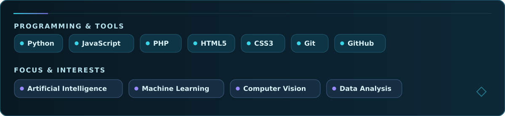
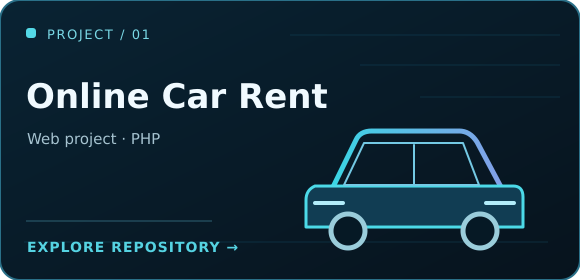
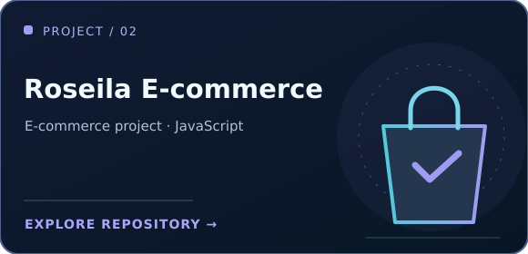
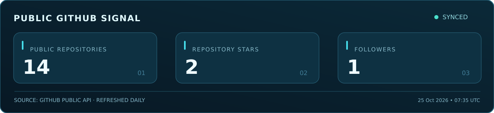

  
  
  

    
    
    
  

### 01 / About me

I'm a **Computer Science and Engineering undergraduate at American International University-Bangladesh (AIUB)**, interested in building practical software and exploring how AI can help solve real-world problems.

- **I build:** Web Applications and Software Projects.
- **I'm exploring:** Artificial Intelligence, Machine Learning, Deep Learning, Natural Language Processing, Computer Vision, and Data analysis.
- **I value:** Hands-on Learning, Experimentation, Clear Documentation, and Thoughtful Engineering.

> Building software. Exploring intelligent systems.

### 02 / Technologies & interests

Languages and tools are shown separately from my current learning and research interests.

### 03 / Featured work

**More work:** [Explore all repositories](https://github.com/ArafatJamil254?tab=repositories) · [Explore my portfolio](https://arafatjamil.pro.bd/)

### 04 / GitHub activity

  

  <picture>
    <source media="(prefers-color-scheme: dark)" srcset="./assets/github-snake-dark.svg" />
    <source media="(prefers-color-scheme: light)" srcset="./assets/github-snake.svg" />
    
  </picture>

  
<strong>Learning highlights</strong>

   

  - **IBM AI Literacy** — certificate.
  - **Get started with AI in Azure** — Microsoft Learn achievement.

  See my [LinkedIn profile](https://www.linkedin.com/in/md-arafat-jamil-434276350/) for more of my learning journey.

### 05 / Let's connect

I'm interested in connecting with developers, fellow learners, and researchers working on meaningful technology.

**[Portfolio](https://arafatjamil.pro.bd/)** · **[LinkedIn](https://www.linkedin.com/in/md-arafat-jamil-434276350/)** · **[GitHub](https://github.com/ArafatJamil254)**

  

